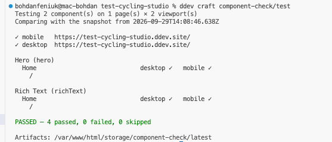
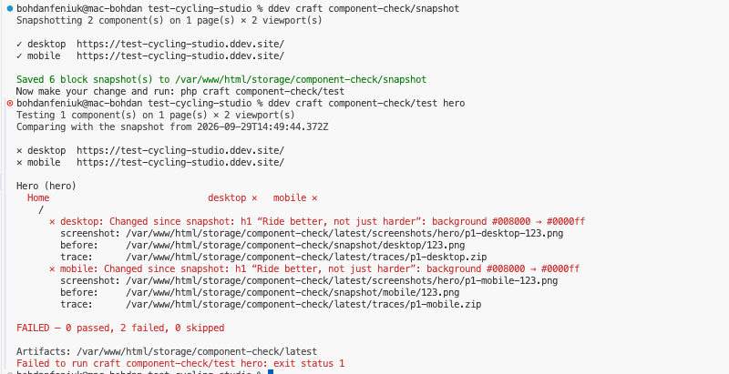
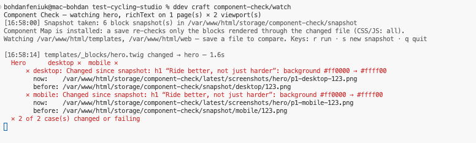

# Component Check

**You changed the Hero. Which pages just broke on mobile?** Craft already knows
where every Hero is used. Component Check asks Craft, picks the pages worth
testing, and runs desktop and mobile browser checks on them with Playwright —
without a single test file.

```
$ php craft component-check/snapshot hero       # before the change
$ # …edit _blocks/hero.twig…
$ php craft component-check/test hero

Hero (hero)
  Home                             desktop ✓   mobile ✕
    /
      ✕ mobile: Changed since snapshot: h1 “Fitting, coaching and servici…”:
        width 334→1200px, now cut off by 235px; p “Book”: moved 0, -37px
        screenshot: storage/component-check/latest/screenshots/hero/p1-mobile-123.png
        before:     storage/component-check/snapshot/mobile/123.png
        trace:      storage/component-check/latest/traces/p1-mobile.zip

FAILED — 1 passed, 1 failed, 0 skipped
```

It is not a replacement for Playwright, Pest or Craft Pest. Playwright does the
browser work; Craft knows the content model; this plugin connects the two.

> Free (MIT). Craft CMS 5, for local development, staging and CI.

---

## How it works

```
Matrix fields ─► every block on a live page ─► representative pages ─► manifest.json
                                                                           │
          report / JSON / exit code ◄── results.json ◄── Playwright (desktop, mobile)
```

1. **Discovery.** Every Matrix field, every block (nested entry), walked up to
   the page that owns it. Only live pages count: enabled, for that site, not a
   draft or revision.
2. **Sampling.** Usages are grouped into *variants* — same section, page type,
   site and the same set of filled-in fields (plus the value of dropdowns,
   radio buttons and lightswitches). Pages are chosen so every variant is
   covered with as few pages as possible. 3,000 identical Heroes → one page.
3. **Browser checks**, on every viewport — see [What fails, what warns](#what-fails-what-warns).
4. **Before/after**, if you took a snapshot: every block is compared with how
   it looked before your change.
5. **Artifacts** for every failure: a screenshot of the failing component (not
   the whole page), the snapshot's screenshot next to it, and a Playwright
   trace.

## What fails, what warns

A plugin cannot know what the designer intended. A heading cut off by
`overflow: hidden` is a bug on one site and the design on another. So there are
two kinds of verdict:

**Failures** — wrong whatever the intent:

- the page answers 4xx/5xx, throws an uncaught JavaScript error, or fails to
  load a script or stylesheet;
- a block that is in the content is not on the page, or renders with no size;
- an image in a block does not load;
- **a block changed since the snapshot** (below).

**Warnings** — often a bug, sometimes the design; they never fail a run:

- the page scrolls sideways;
- a block is wider than the viewport;
- text in a block is cut off by an `overflow: hidden` ancestor.

## Before and after: snapshots

The question a regression test really asks is not *“is this bad?”* but *“did
my change change this?”* — and that one needs no guessing:

```bash
php craft component-check/snapshot hero     # how the Hero blocks look now
# …change the template or CSS…
php craft component-check/test hero         # what changed since
```

Nothing changed:



The Hero's heading got a different background:



A snapshot records, per block and viewport, its geometry (every element's
size and position within the block, its text, colour, background, font, and
whether it is cut off) and a screenshot. `test` then reports changes in words —
`h1 “…”: width 334→1200px, now cut off by 235px` — above the pixel tolerance
(`tolerance`, 2px). Movement is measured relative to the parent, so a
container that moves does not report every child as moved.

- **Content edits are not regressions.** Craft knows when each block was last
  saved. If an editor changed a block after the snapshot, it is not compared
  — `test` says so instead of flagging it.
- **Local by default.** Snapshots live in `storage/component-check/snapshot/`,
  for this machine and this database. `snapshot hero` keeps the snapshots of
  other components; `--reset` starts over. To share one with your team and CI,
  see [A shared baseline](#a-shared-baseline).
- **No snapshot, no comparison:** `test` then checks for errors only.
  `--no-snapshot` skips the comparison on purpose.
- Needs mode `full` (blocks are found by their markers).

### Watch mode

For the edit–save–look loop, run this in its own terminal:

```
$ ddev craft component-check/watch hero

Component Check — watching hero on 1 page(s) × 2 viewport(s)
[10:42:05] Snapshot taken: 2 block snapshot(s) in storage/component-check/snapshot
Watching templates, web — save a file to compare. Keys: r run · s new snapshot · q quit

[10:42:13] _blocks/hero.twig changed — 1.4s
  Hero  desktop ✓  mobile ✕
      ✕ mobile: Changed since snapshot: h1 “Fitting, coaching…”: width 334→1200px, now cut off by 235px
        now:    storage/component-check/latest/screenshots/hero/p1-mobile-123.png
        before: storage/component-check/snapshot/mobile/123.png
  ✕ 1 of 2 case(s) changed or failing

[10:42:51] _blocks/hero.twig changed — 1.2s
  Hero  desktop ✓  mobile ✓   (mobile fixed)
  ✓ all 2 case(s) match the snapshot
```

With [Component Map](#with-component-map-test-only-what-you-changed) installed, a save re-checks only the blocks rendered through that file:



- The snapshot taken at start is *how it was before you started*. Press `s`
  when a change is intended and should become the new “before”.
  `--keep-snapshot` reuses the existing snapshot instead.
- Content is discovered once and one browser stays open, so a save is checked
  in a second or two.
- It polls (`watchInterval`, 700ms) rather than relying on file events, which
  do not reliably cross the Docker mount between your machine and DDEV.
  Only `.twig`, `.html`, `.css`, `.js`, `.mjs`, `.svg` and `.json` files count;
  `watchIgnore` skips `cpresources`, `node_modules`, `uploads`, `assets`.
- Watches `@templates` and `@webroot` by default (`watchPaths`, or `--paths`).
  If your CSS is built by Vite or Tailwind, the built files in `web/` are what
  trigger a run — keep the build watcher running too.
- Restart it after editing content in the control panel.

## With Component Map: test only what you changed

[Component Map](https://plugins.craftcms.com/component-map) knows which
blocks each template is rendered through. With it installed:

```bash
php craft component-check/test --changed        # your uncommitted changes
php craft component-check/test --since=main     # everything on your branch
```

```
Changed files affect hero.
Testing 1 component(s) on 1 page(s) × 2 viewport(s)
```

- Changing `_components/card.twig` tests the blocks that render cards, not
  the whole site. Changing the dispatcher or a layout tests every block.
- Changing CSS, JS or PHP — or anything built into `web/` — tests
  everything: any page can look different, and no map can say which.
- Files that never reach the browser are ignored and listed: docs, dotfiles
  (`.ddev/`, `.github/`, `.env`), `composer.json`/`.lock`, `package.json` and
  other lockfiles, `config/project/` (Component Map already turns content model
  changes into the blocks they affect). After a `composer update`, run a full
  `test`.
- If nothing you changed renders a block, nothing runs (exit code `0`).

`watch` without components uses it too: each save re-checks only the blocks
rendered through the file you saved.

The two plugins talk through Component Map's documented JSON
(`component-map/impact --json`), so each can be updated on its own.

## Requirements

- Craft CMS 5, PHP 8.2+
- Node 18+ **where `php craft` runs**, with `playwright` installed in the
  project (see Setup). Only needed to run tests — not on production.

## Setup

```bash
composer require b10k/craft-component-check
php craft plugin/install component-check

npm install --save-dev playwright
npx playwright install --with-deps chromium

php craft component-check/doctor
```

`doctor` checks the mode, Node, Playwright, Chromium, the output directory,
whether the site answers at the discovered URLs, and whether your templates
have markers — and says how to fix whatever is missing.

**DDEV:** run everything with `ddev exec` / `ddev craft …`; Node is already in
the web container (`nodejs_version` in `.ddev/config.yaml`). Chromium needs its
system libraries, which `--with-deps` installs; add
`webimage_extra_packages` or a post-start hook if you want that to survive
`ddev restart`.

## Markers: from page checks to component checks

Without markers you get page-level checks. With them, the browser knows exactly
which DOM belongs to which block. Add them once, in the loop that renders your
blocks — no component needs to change:

```twig

    {{ craft.componentCheck.start(block) }}
    
    {{ craft.componentCheck.end() }}

```

Or, on a component's root element:

```twig
<section class="hero" {{ craft.componentCheck.attributes(block) }}>
```

**These render nothing** unless the request comes from a test run: the mode is
`full` *and* the request carries a signed, short-lived token that only the
`test` command can create. Visitors, editors, crawlers and production get
exactly the markup they got before. A marked-up response is sent with
`Cache-Control: no-store` so it never lands in a shared cache.

Markers nest (a card inside a cards grid); `end()` closes the most recent
`start()`.

## Commands

| Command | What it does | Needs mode |
|---|---|---|
| `component-check/discover [components]` | Where each component is used and which pages would be tested. `--all` lists every page, `--json` prints the manifest. | `readonly` |
| `component-check/snapshot [components]` | Records how blocks look now, for the next `test` to compare against. `--reset`, `--viewport`, `--snapshot-path`, `--json`. | `full` |
| `component-check/watch [components]` | Snapshots once, then re-checks on every save of a template or stylesheet. Keys: `r` run, `s` new snapshot, `q` quit. `--keep-snapshot`, `--paths`, `--viewport`, `--snapshot-path`. | `full` |
| `component-check/test [components]` | Runs the browser checks, and compares with the snapshot if there is one. `--changed` / `--since=main` test only what your changes affect (needs Component Map). `--viewport=mobile`, `--no-snapshot`, `--snapshot-path`, `--json`, `--headed`. | `readonly` (page checks) / `full` (component checks, snapshots) |
| `component-check/doctor` | Checks the setup. `--json`. | any |

`components` is a comma-separated list of entry type handles: `hero,cards`.

**Exit codes:** `0` passed · `1` regressions found · `2` could not run (mode
off, setup problem, unknown component). Stable, so CI and coding agents can
branch on them.

### JSON

```bash
php craft component-check/test hero --json
```

```json
{
  "status": "failed",
  "passed": 3,
  "failed": 1,
  "skipped": 0,
  "error": null,
  "components": {
    "hero": { "desktop": "passed", "mobile": "failed" }
  },
  "failures": [
    {
      "component": "hero",
      "url": "https://site.test/about",
      "title": "About",
      "viewport": "mobile",
      "reasons": ["Block #1823 is 318px wider than the viewport"],
      "screenshot": "/…/storage/component-check/latest/screenshots/hero/p2-mobile-1823.png",
      "trace": "/…/storage/component-check/latest/traces/p2-mobile.zip"
    }
  ],
  "outputDir": "/…/storage/component-check/latest",
  "manifest": "/…/latest/manifest.json",
  "results": "/…/latest/results.json"
}
```

Open a trace with `npx playwright show-trace <file>`.

## Environments and modes

The plugin installs on **every** environment, production included — project
config stays identical, and the Twig helpers never break a template. What it
does depends on the mode:

| Mode | Discovery | Page checks | Markers in HTML |
|---|---|---|---|
| `off` | – | – | – |
| `readonly` | ✓ | ✓ | – |
| `full` | ✓ | ✓ | ✓ (signed requests only) |

With no setting, the mode follows `allowAdminChanges`: **`full` where admin
changes are allowed** (development), **`off` where they are not** (production,
and usually staging). A plugin cannot reliably tell staging from production, so
an explicit setting always wins:

```bash
# .env on staging / in CI
COMPONENT_CHECK_MODE=full
```

## Configuration

Copy `vendor/b10k/craft-component-check/src/config.php` to
`config/component-check.php`. Highlights:

| Setting | Default | |
|---|---|---|
| `mode` | `''` (auto) | `off`, `readonly`, `full` |
| `baseUrl` | `''` | Replace scheme/host of discovered URLs (CI, Docker) |
| `fields` | `[]` (all) | Matrix field handles to scan |
| `samplesPerVariant` | `1` | Pages per variant |
| `maxPagesPerComponent` | `10` | Cap per component |
| `viewports` | desktop 1440×900, mobile 390×844 | Add `isMobile` to override the touch/mobile heuristic |
| `ignoreErrors` | `[]` | Substrings of JS errors to ignore |
| `blockRequests` | GTM, GA, Facebook, Hotjar | Blocked in the browser |
| `outputPath` | `@storage/component-check` | Artifacts go to `…/latest/` |
| `snapshotPath` | `''` | Where snapshots live. Empty = `snapshot/` inside `outputPath`, local. A folder in the repository makes a [shared baseline](#a-shared-baseline). Env: `COMPONENT_CHECK_SNAPSHOT_PATH` |
| `concurrency` | `4` | Pages in parallel |
| `tolerance` | `2` | Pixels an element may move or resize before a snapshot comparison reports it |
| `watchPaths` | `@templates`, `@webroot` | What `watch` watches |
| `watchIgnore` | `cpresources`, `node_modules`, `uploads`, `assets` | Folder names `watch` skips |
| `watchInterval` | `700` | How often `watch` looks for changes (ms) |

## CI

```yaml
- run: npm ci && npx playwright install --with-deps chromium
- run: php craft component-check/test --json > component-check.json
  env:
    COMPONENT_CHECK_MODE: full
- uses: actions/upload-artifact@v4
  if: failure()
  with:
    name: component-check
    path: storage/component-check/latest
```

The results are only as representative as the database the job runs against:
use a recent content snapshot.

### A shared baseline

Without a snapshot, CI checks for errors: broken pages, missing blocks, failed
scripts. To also catch *visual* changes on every pull request, commit a
snapshot to the repository and let CI compare against it:

```php
// config/component-check.php
return [
    'snapshotPath' => '@root/tests/component-check',
];
```

or per command: `--snapshot-path=tests/component-check` (relative to the
project root). Then:

```bash
php craft component-check/snapshot          # record the baseline
git add tests/component-check && git commit -m "Component Check baseline"
```

From then on `test` and `watch` compare against it, and so does CI. When a
change is intended, re-record the components it touched (`snapshot hero`) and
commit the new baseline with the change — the pull request then shows the
before/after screenshots of what was accepted.

A baseline is tied to two things, so keep them together:

- **The database.** Blocks are matched by ID, and a block whose content was
  edited after the baseline is skipped, not compared. Record the baseline
  against the same content dump CI restores, and re-record when you refresh
  the dump.
- **The browser and OS.** The same page can measure a pixel differently in
  another Chromium or with other fonts. The snapshot records what rendered it;
  when `test` runs somewhere else it says so (`The snapshot was taken with
  chromium 141…, darwin-arm64; this run uses … linux-x64`), so rendering
  differences are not mistaken for your change. DDEV and GitHub's
  `ubuntu-latest` are both Linux; with the same Playwright version they
  usually agree. If they do not, record the baseline in CI (a manually
  triggered job running `snapshot` and committing the folder) instead of on
  your laptop.

A GitHub Actions job against a content dump, using Craft's built-in server:

```yaml
jobs:
  components:
    runs-on: ubuntu-latest
    services:
      mysql:
        image: mysql:8.0
        env: { MYSQL_ROOT_PASSWORD: root, MYSQL_DATABASE: craft }
        ports: ['3306:3306']
        options: --health-cmd="mysqladmin ping" --health-interval=5s --health-retries=10
    env:
      CRAFT_DB_DRIVER: mysql
      CRAFT_DB_SERVER: 127.0.0.1
      CRAFT_DB_PORT: 3306
      CRAFT_DB_DATABASE: craft
      CRAFT_DB_USER: root
      CRAFT_DB_PASSWORD: root
      CRAFT_SECURITY_KEY: ${{ secrets.CRAFT_SECURITY_KEY }}
      COMPONENT_CHECK_MODE: full
      COMPONENT_CHECK_BASE_URL: http://localhost:8080
      PHP_CLI_SERVER_WORKERS: 4
    steps:
      - uses: actions/checkout@v4
      - uses: shivammathur/setup-php@v2
        with: { php-version: '8.2' }
      - uses: actions/setup-node@v4
        with: { node-version: 20 }
      - run: composer install --no-interaction --prefer-dist
      - run: npm ci && npx playwright install --with-deps chromium
      - run: php craft db/restore tests/content.sql   # your content dump
      - run: php craft up --interactive=0
      - run: php craft serve localhost:8080 > /dev/null 2>&1 &
      - run: php craft component-check/test
      - uses: actions/upload-artifact@v4
        if: failure()
        with:
          name: component-check
          path: storage/component-check/latest
```

On failure the artifact holds, for every changed block, the screenshot from
the baseline next to the one from this run, and a Playwright trace.

## Craft's MCP server (Craft 5.12+)

Craft 5.12 has an MCP server built in. Component Check adds to it what an
agent cannot work out from the content model or the files — what only a
browser run knows. All of it read only: nothing starts a browser, writes a
snapshot or changes content. Running the checks stays a shell command.

- **In `info.get`'s instructions** (control-panel users): the mode, how the
  last run went and when, whether templates changed since, which snapshot
  `test` compares against (local or a committed baseline, and where it was
  taken), and how to run a check.
- **`component-check.results`**: the last run, case by case — block × page ×
  viewport — failures first, with the reasons in words and the paths to the
  screenshots. Filter by component, status or viewport.
- **`component-check.usages`**: the live pages each block is on, its variants,
  and which pages a run tests.
- **`component-check.screenshot`**: a block as the run saw it and as the
  snapshot has it, as images — for agents that cannot open files on the
  server.
- **`component-check-coverage` in `content-model.audit`** (admins): blocks the
  snapshot no longer covers (edited or deleted since), and blocks the last run
  could not locate because they have no markers.

The tools need control-panel access and only appear where the mode is not
`off`, so on production there is nothing. On Craft before 5.12 nothing
changes. If a later Craft no longer accepts what the plugin hands its MCP
server, the plugin leaves its part out and logs a warning (category
`component-check`); the rest of the server keeps answering.

To try it locally: `php craft mcp/serve --user=<id or username>` (stdio), or
enable the server in Settings → MCP and connect your agent to
`https://<site>/admin/mcp`.

## Coding agents

The loop this plugin is built for: `snapshot <component>`, change it, run
`test <component> --json` (or `test --changed --json` with Component Map),
read what changed, look at the before/after screenshots, fix or accept, run
again. See [AGENTS.md](AGENTS.md) for the recipe to hand your
agent.

## Limitations

- **Matrix only.** Neo, Super Table and custom page builders are not discovered
  yet.
- **Chromium only.**
- **Snapshots compare geometry and computed style, not pixels.** A changed
  colour, font or size is caught; a changed background image or icon is not.
  The before/after screenshots are there for a human (or an agent) to look at.
- **Snapshots are local.** Shared baselines for a team or CI are not there
  yet.
- **Static caches.** Blitz and similar serve HTML before Craft runs, so marker
  requests may get the cached copy without markers. Exclude the test run (or
  disable the static cache) in environments where you test.
- **`` tags** can serve markup cached without markers.
- **Your data decides.** A component with no content on a live page cannot be
  tested; `discover` lists those.

## Development

```bash
composer install && composer check     # PHPUnit + PHPStan
npm install --no-save playwright && npx playwright install chromium
npm test                                # runner unit tests + real-browser tests
```

The core — mode rules, tokens, sampling, the manifest, the report — is
Craft-free and unit-tested. The runner's checks are pure functions, tested
without a browser; a second suite drives real Chromium against a fixture site.

## License

MIT
